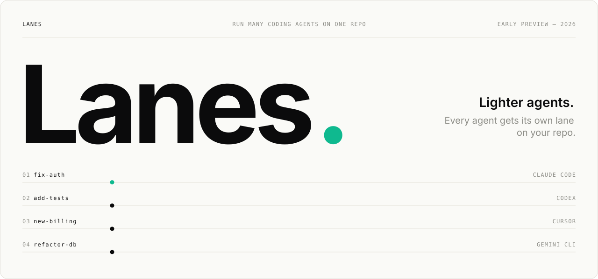
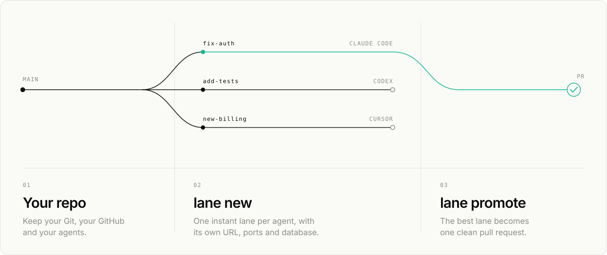
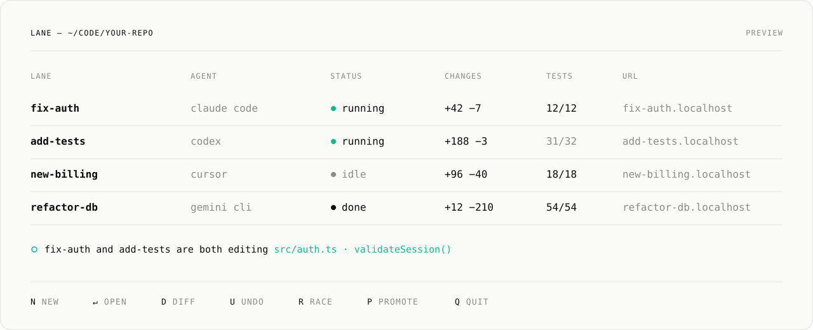
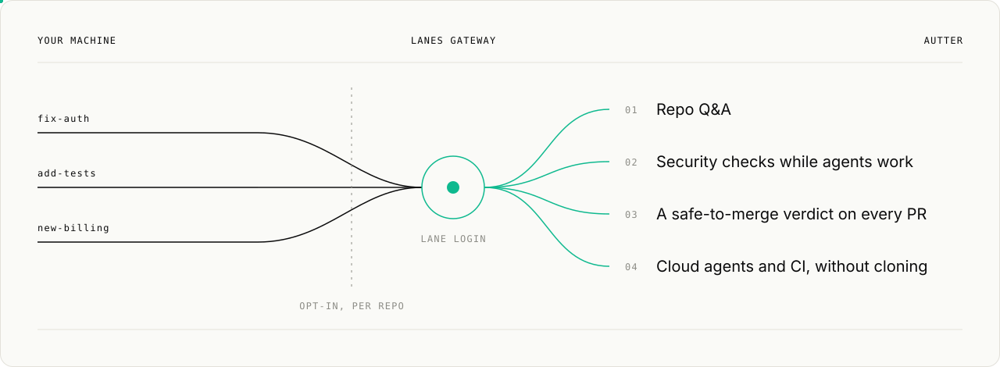

<picture>
  <source media="(prefers-color-scheme: dark)" srcset="assets/hero-dark.svg">
  
</picture>

<br>
<br>

<p align="center">
  Run as many coding agents as you want on one repo,<br>
  without them getting in each other's way.
</p>

<p align="center">
  <a href="https://lanes.autter.dev"><b>lanes.autter.dev</b></a> &nbsp;·&nbsp;
  <a href="#01--why-lanes">Why</a> &nbsp;·&nbsp;
  <a href="#02--how-it-works">How it works</a> &nbsp;·&nbsp;
  <a href="#03--features">Features</a> &nbsp;·&nbsp;
  <a href="#05--lanes-gateway">Gateway</a> &nbsp;·&nbsp;
  <a href="#06--status">Status</a> &nbsp;·&nbsp;
  <a href="#07--quick-start">Quick start</a> &nbsp;·&nbsp;
  <a href="#08--commands">Commands</a> &nbsp;·&nbsp;
  <a href="CHANGELOG.md">Changelog</a>
</p>

<p align="center">
  <a href="https://github.com/autter-dev/lanes/actions/workflows/ci.yml"></a>
  <a href="LICENSE"></a>
  
  
</p>

<br>

Every agent gets its own instant copy of your project, with dependencies ready and its own ports, URL and database. You keep your Git repo, your GitHub and your agents. Nothing to migrate.

> [!NOTE]
> Lanes is early and in active development. We're building it in public: star or watch this repo for releases, and follow along at [@sagnik_ghosh_11](https://x.com/sagnik_ghosh_11).

<br>

## 01 / Why Lanes

Running several coding agents today usually means:

- a full copy of your repo for every agent
- a fresh `npm install` (or `cargo build`, or `pip install`) for every copy
- five dev servers fighting over port 3000
- agents breaking each other's database with their migrations
- finding out two agents edited the same function only when you merge

Lanes gives each agent a **lane** instead.

<br>

## 02 / How it works

<picture>
  <source media="(prefers-color-scheme: dark)" srcset="assets/how-it-works-dark.svg">
  
</picture>

<br>

## 03 / Features

**Instant lanes**<br>
A ready-to-run copy of your project for each agent, dependencies included, using almost no extra disk space. A lane is a normal folder, so your editor, compiler and test runner all just work.

**Every lane is a live app**<br>
Its own ports and URL, like `fix-auth.localhost`. Its own `.env`, its own database copy (Postgres, SQLite) and its own Docker Compose project. Open five versions of your app side by side.

**Works with the agents you already use**<br>
Claude Code, Cursor, Codex, Gemini CLI, GitHub Copilot, Conductor, Amp, OpenCode, Cline and Aider. When any of them creates a Git worktree, it becomes a lane automatically, so your agents don't need to learn anything new. A built-in MCP server lets agents create lanes and read code in one call, and cloud agents need one line in their setup script.

**No more collisions**<br>
A warning when two agents start editing the same file or function, while they're still working.

**Undo anything**<br>
A checkpoint after every agent step. `lane undo` takes back any step; `lane restore` jumps back to any checkpoint.

**Best of N**<br>
`lane race -n 3 "fix the flaky checkout test"` gives one task to three agents, runs the tests in each and shows a scoreboard. You keep the best one. `lane combine a b` lets you try two lanes together before merging either.

**Ship clean PRs**<br>
`lane promote` turns an agent's work into one clean pull request, with who (and which agent) wrote what. Protected paths, like `migrations/` or CI config, need a human to sign off.

**Kind to your laptop**<br>
Builds and tests take turns, so five agents don't freeze your machine. Dev servers start only when you open them.

**Your code stays on your machine**<br>
Works offline. Signing in is optional, and connecting a repo to the gateway is always your choice. The only thing Lanes sends is an anonymous install count: version, OS and how you installed it. Never code, file paths or repo names. Turn it off with `lane telemetry off` or `DO_NOT_TRACK=1`.

**Ready for teams**<br>
`lane login` signs you into [Autter](https://autter.dev) and connects your lanes to the Lanes gateway on Autter. Cloud agents and CI read your repo without cloning, and you get repo Q&A, security checks while agents work, and a safe-to-merge verdict on every PR. See [the Lanes gateway](#05--lanes-gateway).

<br>

## 04 / The terminal app

Run `lane` to open a full-screen app: every lane with its agent, changed files, tests, conflicts and disk use. Start agents, watch them work, read diffs and logs, undo steps and open PRs without leaving it.

<picture>
  <source media="(prefers-color-scheme: dark)" srcset="assets/terminal-app-dark.svg">
  
</picture>

<p align="center"><sub>Preview. The terminal app is being built now.</sub></p>

<br>

## 05 / Lanes gateway

Lanes is free, open source and works fully offline. The Lanes gateway is the optional bridge to [Autter](https://autter.dev), for teams that want every lane checked while agents work and reachable from the cloud.

> [!IMPORTANT]
> You don't need Autter to use Lanes. Everything except the gateway itself works without an Autter account, and Lanes is, and always will be, maintained as its own project, independently of Autter or any other product.

<picture>
  <source media="(prefers-color-scheme: dark)" srcset="assets/gateway-dark.svg">
  
</picture>

**How it works**

1. Run `lane login` to sign in to Autter.
2. Choose which repos to connect. Nothing is shared until you do, and every other repo stays on your machine.
3. Your lanes in connected repos reach Autter through the gateway. Cloud agents and CI read the repo through it without cloning, and Autter checks each lane as its agent works.

**How an Autter review runs on a lane**

Autter's reviews are hosted entirely in Autter's cloud. The lane stays on your machine and nothing extra runs locally: for connected repos, the gateway lets the review read the lane's changes, Autter runs code review, security checks and tests on its side while the agent is still working, and the findings come back to the lane, with a safe-to-merge verdict on the PR.

**What you get**

- **Repo Q&A.** Ask about your repo, or any change in a lane, in plain English.
- **Security checks while agents work**, not after the PR is open.
- **A safe-to-merge verdict on every PR**, including the ones `lane promote` opens.
- **Cloud agents and CI without cloning.** They read the repo through the gateway.

**Where it's going**

The gateway arrives in December. Over time, it turns Lanes and Autter into one loop, from an agent's first step to a verified fix in production:

| | |
| --- | --- |
| **Write** | Agents work in lanes, on your machine or in the cloud. |
| **Check** | Autter reviews, tests and security-checks each lane while it's still in progress. |
| **Ship** | `lane promote` opens one clean PR, and Autter's verdict says when it's safe to merge. |
| **Fix** | When something breaks in production, Autter traces it and the fix comes back as a new lane, which goes through the same checks. |

**What stays the same**

- Autter is never required. Lanes stays open source under the AGPL-3.0, works fully without Autter, and is maintained independently of it.
- Connecting is opt-in, one repo at a time.
- Repos you don't connect never leave your machine. For them, Lanes sends only the anonymous install count, which you can turn off.

<br>

## 06 / Status

| Feature | When |
| --- | --- |
| Instant lanes, `lane init`, ports and env per lane | ● Now |
| Terminal app | ● Now |
| Claude Code integration, MCP server | ● Now |
| Sign-in to Autter (`lane login`) | ○ Next |
| Cursor, Codex, Gemini CLI, Copilot and other agents | ○ Next |
| Databases and Docker Compose per lane, `*.localhost` URLs | ○ Next |
| Undo, conflict warnings, `lane race`, `lane promote` | ○ Next |
| Cloud agent setup snippets, GitHub Action | ○ Next |
| Lanes gateway on Autter | ○ December |
| Windows: fast on a Windows 11 Dev Drive, regular NTFS drives supported | ○ Next |

macOS, Linux and Windows at launch. On Windows, Lanes is fastest on a Windows 11 Dev Drive and also works on regular NTFS drives. WSL2 uses the Linux build.

<br>

## 07 / Quick start

Install commands go live with the first release. Every one installs the same `lane` command.

| On | Install with |
| --- | --- |
| macOS, Linux, WSL | `brew install autter-dev/tap/lanes`, or `curl -fsSL https://github.com/Autter-dev/lanes/releases/latest/download/lanes-installer.sh \| sh` |
| Windows | `winget install Autter.Lanes`, or `scoop install lanes` after `scoop bucket add autter https://github.com/Autter-dev/scoop-bucket`, or `irm https://github.com/Autter-dev/lanes/releases/latest/download/lanes-installer.ps1 \| iex` |
| Anywhere with Node | `npm install -g @autter/lanes` |

Or download an archive from [GitHub Releases](https://github.com/Autter-dev/lanes/releases).

```sh
brew install autter-dev/tap/lanes
cd your-repo
lane init                    # finds your stack and sets up your agents
lane new fix-auth            # a ready-to-run lane
lane exec fix-auth -- npm run dev
open http://fix-auth.localhost
```

<br>

## 08 / Commands

| Command | What it does |
| --- | --- |
| `lane` | Opens the terminal app, with a short welcome the first time |
| `lane setup` | Checks your machine and chooses your settings (`--json` and `--yes` for scripts) |
| `lane init` | Sets up Lanes for your repo and the agents you use |
| `lane new <name>` | Creates a lane |
| `lane list` | Lists your lanes with their ports and URLs |
| `lane exec <name> -- <cmd>` | Runs a command inside a lane |
| `lane run -- <agent>` | Starts any agent in a fresh lane |
| `lane undo` / `lane restore` | Takes back a step, or returns to a checkpoint |
| `lane race -n <N> "<task>"` | One task, N agents, best result wins |
| `lane combine <a> <b>` | Tries two lanes together |
| `lane promote <name>` | Turns a lane into one clean PR |
| `lane rm <name>` / `lane gc` | Removes one lane, or every finished one |
| `lane login` | Signs in to Autter and connects the Lanes gateway (optional) |
| `lane telemetry off` | Turns off the anonymous install count |

<br>

## 09 / FAQ

<details>
<summary>Does it replace Git?</summary>
<br>

No. Lanes works on top of the Git repo and the GitHub you already use.

</details>

<details>
<summary>Does my code leave my machine?</summary>
<br>

Not unless you choose to connect a repo to the Lanes gateway on Autter. Otherwise Lanes runs locally, and the only thing it sends is an anonymous install count (version, OS and how you installed it), which you can turn off.

</details>

<details>
<summary>Do I need Autter to use Lanes?</summary>
<br>

No. Autter is optional, and everything except the gateway itself works without it. Lanes is, and always will be, maintained as its own open source project, independently of Autter or any other product. The Lanes gateway is only for teams who choose to connect.

</details>

<details>
<summary>Is it free?</summary>
<br>

Yes. Lanes is open source under the GNU AGPL-3.0. You can use, change and share it freely. If you share a changed version, or run one as a service for others, you must publish your changes under the same license. Autter, for teams, is a paid product.

</details>

<details>
<summary>Is this related to Anthropic's Scion?</summary>
<br>

Lanes is inspired by ideas Anthropic shared about how it scaled source control for agents. We are not affiliated with Anthropic.

</details>

<br>

## 10 / Contributing

Lanes is early. Issues, ideas and benchmarks from your own repos are very welcome. Please open an issue before sending a large PR. See [CONTRIBUTING.md](CONTRIBUTING.md) for details, and [CHANGELOG.md](CHANGELOG.md) for what has changed.

## 11 / License

GNU Affero General Public License v3.0 only (AGPL-3.0-only). See [LICENSE](LICENSE).

<br>
<br>

<p align="center">
  <a href="https://autter.dev">
    <picture>
      <source media="(prefers-color-scheme: dark)" srcset="assets/autter-logo-dark.webp">
      
    </picture>
  </a>
</p>

<p align="center">
  <sub>Lanes is built by <a href="https://autter.dev">Autter</a>: code Q&amp;A, security checks and safe-to-merge verdicts for teams shipping with agents.</sub>
</p>
